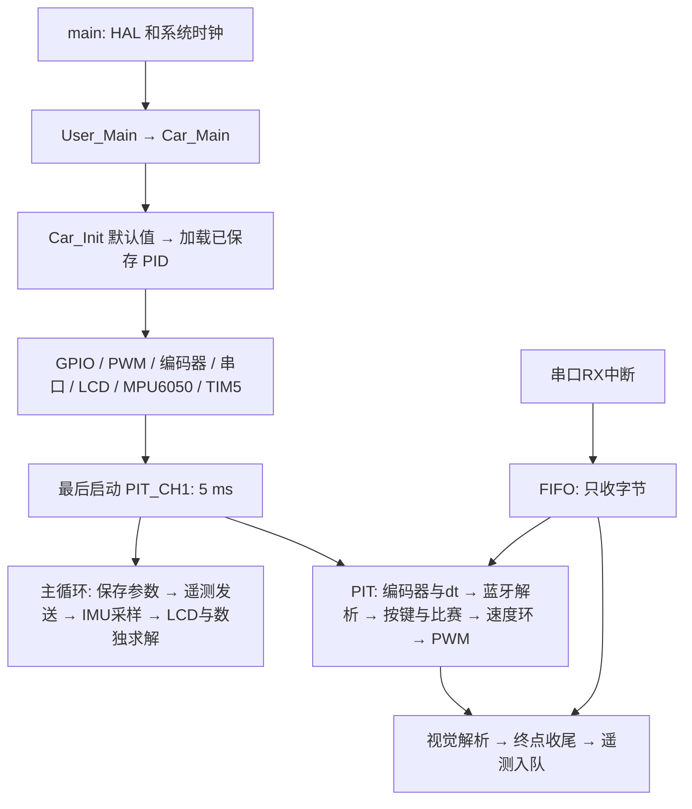

# 下位机控制代码开发交接文档

更新：2026-11-14。适用：STM32F407VET6、双轮差速底盘、MPU6050、香橙派 vision1.2。读者：接手或共同开发底盘控制、赛项动作、驱动、菜单和调参工具的人员。

本文描述当前实际实现，区分已实现功能与后续工作；视觉人员另读 [视觉组交接](Vision12_Handover.md)，线协议详见 [视觉通信接口](Vision_Interface.md)。参数保存操作见 [PID 掉电保存](PID_Storage.md)。旧 [控制架构方案](Control_Architecture.md) 包含未来设计，不能据此假定所有模块已经实现。

## 1. 当前交付状态与版本

| 项目 | 当前情况 |
|---|---|
| 工作目录 | `D:\smart_car` |
| Git 基线 | `9162479`：`feat: integrate vision1.2 with F407 race control and Sudoku handover` |
| 基线之后的功能提交 | PID 掉电保存、菜单第四项、启动加载、Flash 保留区及相应测试/文档，与本文一并纳入版本管理 |
| 控制方式 | 按键发车的自主比赛；蓝牙手动轮速调试 |
| 已实现 | 双轮速度闭环、保护与停车、视觉接收、比赛动作、MPU6050 Z 轴校零/角速度、三级菜单、数独终点求解、PID 持久化 |
| 当前验证 | 主机软件测试及 Keil 编译通过；尚未完成本次版本的实车烧录、实际 Flash 断电与赛道验收 |
| 正式赛题缺口 | 真正停车点、现场软件盲盒未接入；目前按两圈累计里程作练习终点 |

**只检出上述基线提交不含最新 PID 保存功能。** 接手时使用包含本文和 `Pid_Storage.c` 的版本，可用 `git log -1 -- Docs/Control_Development_Handover.md` 查询本交接文档对应的提交。不要只拷贝 `Menu_Task.c`，否则可能漏掉 Flash 代码和链接区配置。

最新已核对的固件：

```text
MDK-ARM/NEUQ_STM32F407VET6_Opensource_Library/
  NEUQ_STM32F407VET6_Opensource_Library.hex
SHA256: A4090473B087C02703805853C36AC6FF07263C7D5B581BD4B50E3C32BFDEFB96
```

这是本文编写时的构建指纹；修改源码并重新编译后需重新记录，不能用旧指纹代表新版本。

## 2. 新开发人员先做什么

1. 阅读本文第 3–5 节，找到入口、执行上下文和硬件资源；不要从旧单电机任务入口接入。
2. 先跑第 12 节的软件验证，记录本机可复现结果，再修改自己负责的模块。
3. 确认当前车辆使用的是手动还是自主模式，以及要改的是速度内环、任务层还是视觉观测；这三者入口不同。
4. 修改前与其他人员约定文件边界，尤其是 `Platform_Main.c`、`Board_Config.h`、`Task_Fsm.h`、Keil 工程文件。
5. 提交或交接时同时给出源码版本、参数、测试命令、结果和未验证事项。首次联调按第 13 节保存记录。

## 3. 代码地图与建议分工

路径均相对工程根目录。表中的分工是协作建议，不代表已分配给某个人。

| 文件/目录 | 实际职责 | 常见修改归属 |
|---|---|---|
| `Library/HAL_lib/Core/Src/main.c` | HAL/时钟初始化后调用 `User_Main()` | 启动与平台维护 |
| `User/NEUQ_Main.c` | 应用入口，调用 `Platform_Main()` | 平台维护 |
| `User/NEUQ_Interrupts.c` | PIT、串口回调转发 | 平台维护，修改前协调 |
| `CODE/Platform_Main.c/.h` | 平台入口：外设初始化、控制节拍、FIFO、运动输出、前台任务和共享快照 | 硬件/集成人员；保持一个主维护人 |
| `CODE/Board_Config.h` | 引脚、周期、CPR、速度/PWM限幅、PID 默认值和保护阈值 | 全组共同确认配置 |
| `CODE/Menu_Task.c/.h` | 三级导航、调参候选值、发车/保存动作请求、逐行格式化 | 交互人员 |
| `CODE/Drv_Motor.c/.h`、`Drv_Encoder.c/.h`、`Drv_Key.c/.h`、`Drv_Lcd.c/.h`、`Drv_Gyro.c/.h`、`Drv_Clock.c/.h`、`Drv_Uart.c/.h` | 电机 PWM/方向、编码器计数、按键消抖、LCD 缓存刷新、MPU6050、微秒时基和串口收发 | 交互/驱动人员 |
| `CODE/Proto_Bluetooth.c/.h` | 蓝牙帧解析、轮速命令接入与应答 | 通信人员，与底盘控制共同维护契约 |
| `CODE/Proto_Vision.c/.h` | 视觉字节协议、校验、会话/序号、观测与四块缓存 | 通信人员，与视觉侧共同维护契约 |
| `CODE/Proto_Vofa.c/.h` | 遥测整帧入队，前台分次发送 | 通信人员 |
| `CODE/Pid.c/.h` | 位置式与增量式 PID 纯算法；内环速度环调用增量式，外环位置环调用位置式（默认关闭） | 速度环人员 |
| `CODE/Pid_Storage.c/.h` | PID 记录格式、CRC、日志查找、保存/恢复，内部 Flash 扇区读写、擦除和缓存处理 | 参数存储/平台人员 |
| `CODE/Sudoku.c/.h` | 四块拼接、6×6 数独唯一解检查 | 任务/算法人员 |
| `CODE/Task_Fsm.c/.h` | 整车状态、曲率到双轮目标、里程/航向、断路、绕黄障、红障停等、练习终点 | 任务控制人员 |
| `CODE/Track_Fsm.c/.h` | 巡线状态机、手动模式双轮共享进度的五次参考曲线 | 速度环/巡线人员 |
| `Tools/`、`Tests/` | 电脑调试台、协议参考、编译脚本、回归测试 | 修改对应功能的人同步维护 |
| `vision_inspection/vision/` | 香橙派视觉程序 | 图像人员；控制侧变更协议时同步联调 |

推荐阅读顺序：`Board_Config.h → platform/Platform_Main.h → task/Task_Fsm.h/.c → track/Track_Fsm.h → protocol/Proto_Vision.h → menu/Menu_Task.c → pid/Pid_Storage.c`。

## 4. 启动流程、调度与共享数据

当前采用裸机主循环加中断，无 RTOS 任务调度。



### 4.1 控制节拍

`PIT_CH1` 使用 TIM6，标称 5 ms、优先级 0。TIM5 作为微秒时基，`Car_PIT_Handler()` 用计数差得到真实 `dt_us`；正常允许 1000–15000 μs。编码器使用 16 位计数差并处理回绕，不在每拍清零硬件计数器。

每拍按以下顺序执行：

1. 读取 TIM5、左右编码器增量，按配置修正符号，更新采样基准。
2. 若正在保存参数或处于保存后首次恢复节拍，保持零输出并跳过正常控制。
3. 处理蓝牙接收异常；正常时最多消费 32 字节，交给 `Car_FeedByte()`。
4. `race_tick()`：按键扫描/停车优先级、菜单动作、自主任务计算。
5. `Car_TickDt()`：轮速更新、参考值推进、PID、保护；随后 `output()` 提交左右输出。
6. 处理视觉接收异常，或最多消费 64 字节视觉数据；因此本拍动作通常使用上一拍已解析的视觉快照。
7. 处理终点收尾，每 20 拍入队一次遥测。

### 4.2 前台任务

主循环顺序是 `poll_params() → Vofa_poll() → poll_gyro() → poll_menu()`。

- Flash 保存与数独求解都放在前台。不要放进最高优先级 PIT。
- `Vofa_poll()` 每次最多发 4 字节，避免持续阻塞 IMU/LCD 服务。
- IMU 两次采样请求至少间隔 10 ms，是前台轮询，不保证严格 100 Hz。
- LCD 每轮取一致快照，逐行绘制；新一轮快照间隔至少 120 ms，实际刷新还受串口和 I²C 耗时影响。
- 数独求解在终点收尾完成、题面冻结后执行；搜索预算 20000 节点。

### 4.3 多人修改时必须保持的边界

- `car`、`race`、`vision` 和菜单主要由 PIT 更新；前台读取共享状态时使用短临界区复制快照。
- 获取视觉信息优先用 `Car_GetVisionObservation()` / `Car_GetVisionTile()`；返回成功后仍检查有效位、置信度和业务条件。
- `volatile` 不能替代复合数据的一致性保护；不要边更新一半结构体边让另一上下文读取。
- 关中断只用于短快照/状态交接，不能包住整个 I²C、LCD、串口发送、数独求解或 Flash 保存。
- UART RX 回调只入 FIFO，不直接执行动作。任务层输出轮速目标，底层统一提交 PWM。
- `Car_PIT_Handler()` 只能由周期回调调用；不要在主循环重复调用，避免速度和里程累计两次。

## 5. 硬件资源与参数基线

### 5.1 引脚和外设

| 功能 | 当前使用 | 注意事项 |
|---|---|---|
| 左电机 PWM / DIR | TIM8_CH1 PC6 / PC7 | PWM 8 kHz |
| 右电机 PWM / DIR | TIM2_CH3 PA2 / PA5 | PA5 与外部 Flash SPI1 冲突 |
| 左编码器 A/B | TIM4 PB6/PB7 | 正交四倍频 |
| 右编码器 A/B | TIM3 PA6/PA7 | 与外部 Flash SPI1 冲突 |
| 蓝牙 | USART1 PA9 TX / PA10 RX，9600 8N1 | NEUQ 库索引 `UART_0` / `CAR_UART_INDEX=0` |
| 香橙派视觉 | UART4 PC10 TX / PC11 RX，115200 8N1 | NEUQ 索引 `UART_3`；双向：接收观测，PC10 回 STATUS；与蓝牙分属不同串口 |
| 调试打印 | 关闭 | USART1 由蓝牙独占，LCD/I²C 初始化时的 printf 不发送到串口 |
| MPU6050 | I²C3 PA8 SCL / PC9 SDA，400 kHz | 7 位地址 0x68；库宏使用移位地址 `0x68 << 1` |
| LCD | SPI3 PB3 SCK、PB5 MOSI、PB4 CS | DC=PD5，BL=PD3，RST=PE2 |
| 四个按键 | PE10 上、PE8 下、PE7 确认、PE9 返回 | 均低有效；运行/故障时 PE10 优先停车/清最近故障码；历史在 Sensors→故障记录 |
| 电池电压 | ADC1_IN10 / PC0 | 电池必须经分压后接入，引脚 ≤3.3 V；每 60 s 采样一次，菜单显示 |
| 外部 W25Q | PB0 CS，SPI1 PA5/PA6/PA7 | 初始化拉高 PB0 后不使用该 Flash；不能为存参数重新启用 SPI1 |
| 内部参数 Flash | S6/S7：0x08040000–0x0807FFFF | 链接区必须排除，详见第 9 节 |
| 时间资源 | TIM6 控制节拍；TIM5 实际周期计时 | 新功能不得占用这些定时器 |

引脚来源为当前代码；旧注释中出现的外部 Flash 片选描述可能过时，实际使用 `CAR_FLASH_CS=PB0`。

### 5.2 关键参数、单位和修改位置

| 参数 | 当前值 | 修改处/含义 |
|---|---|---|
| 编码器 | 11 PPR × 4 × 减速比 10 = 440 counts/rev | `CAR_ENCODER_CPR`，输出轴每转计数 |
| 电机空载转速记录 | 1000 rpm | `CAR_MOTOR_NOLOAD_RPM`，转速满量程 |
| 目标转速上限 | ±900 rpm（满量程的 90%） | `BOARD_RPM_LIMIT` = `CAR_RPM_MAX × CAR_LIMIT_FRACTION` |
| PWM 上限 | ±9000，满量程 10000（90%） | `BOARD_PWM_LIMIT` = `CAR_PWM_MAX × CAR_LIMIT_FRACTION` |
| 超速报错 | 实测 >900 rpm 持续 100 ms | `CAR_OVERSPEED_RPM`，故障码 8 |
| 参考加速度/加加速度 | 200 rpm/s；800 rpm/s² | `Board_Config.h`；自主流式参考只有加速度限幅，不能声称同时保证 jerk |
| 测速窗口 | 8 个控制周期（40 ms）计数滑动平均 | `TASK_WINDOW_TICKS`；单计数约 3.4 rpm |
| 速度反馈低通 | 0.015 s | `CAR_SPEED_FILTER_TAU_S`；叠加在窗口之后 |
| 默认 PID | 两轮均 Kp=14.0，Ki=1.0，Kd=0 | `CODE/Pid.h`；有效保存记录优先于这些默认值，详见[调参指引](Speed_PID_Tuning_Guide.md) |
| 微分滤波/目标权重 | 0.020 s / 1.0 | `CAR_PID_D_TAU_S` / `CAR_PID_SETPOINT_WEIGHT` |
| 前馈 | Ks/Kv/Ka 均为 0 | `Board_Config.h`，未做本车辨识 |
| 轮半径/轮距 | 0.0325 m / 0.173 m | `CODE/Task_Fsm.h`，轮距为几何初值 |
| 圈长/练习终点 | 55.061 m / 110.122 m | `RACE_LAP_M` / `RACE_FINISH_M` |
| 断路进入位置 | 0 | `RACE_GAP_ENTRY_M`；0 表示不使用固定沿程窗口，仍要求视觉候选及近期直行 |
| 黄障绕行 | 左侧，目标偏移 0.18 m | `RACE_BYPASS_SIDE` / `RACE_BYPASS_OFFSET_M` |

这些数值是代码基线，不等同于整车标定结果；当前没有要求重新开展实测，接手时保留“未验证”标记即可。

坐标统一：轮 0 左、轮 1 右；前进轮速为正；车体向左/逆时针为正。运动学使用 m、s、rad；菜单角速度显示 °/s、航向显示 °。`Track_Step()` 的 `left_m/right_m` 是本周期位移增量，不是累计路程。

```text
raw_rpm = Σ(最近 8 拍 encoder_delta) × 60 / (440 × Σ(最近 8 拍 dt_s))
speed   = 一阶低通(raw_rpm, τ = 0.015 s)
ds      = (left_m + right_m) / 2
dyaw    = (right_m - left_m) / track_m
left_rpm  = (v - omega × track_m/2) × 60 / (2π × radius_m)
right_rpm = (v + omega × track_m/2) × 60 / (2π × radius_m)
```

## 6. 控制模式、接口和故障

整车状态为 `CAR_STOP=0`、`CAR_RUN=1`、`CAR_FAULT=2`，`autonomous` 区分自主与手动。枚举值用于遥测，调整顺序会影响上位机。

| 接口 | 正确用途 | 约束 |
|---|---|---|
| `Car_Init()` | 建立编译默认值和停车状态 | 硬件启动随后加载 PID 记录；不要在运行中用它重置共享对象 |
| `Car_SetPid()` | 修改某一轮完整 Kp/Ki/Kd | STOP 才允许；返回 0 成功、1 状态不允许、2 参数错误；重建该轮控制器动态状态 |
| `Car_StartRace()` | 本地发车后建立自主控制权 | UI/硬件层先验证道路、静止、会话等条件；不能绕过上层门控 |
| `Car_RaceWheels()` | 自主任务提交左右目标 rpm | 只在自主 RUN 有效；刷新自主控制链路计时；双轮零目标重置运动参考 |
| `Car_TickDt()` | 一次速度环/保护推进 | 使用真实 dt；不要重复调用 |
| `Car_LocalStop()` | 本地停车与清故障 | 清目标/参考/PID动态状态和自主权；保留 PID 增益 |
| `Car_Fault()` | 记录故障并撤去输出 | 保留首次故障原因；恢复需显式停车/清故障 |

手动模式使用 `CarReference_Update()` 的双轮共享五次曲线；自主模式每拍跟随流式轮速目标，用两轮共享比例的加速度限幅。当前内环速度环调用 `Car_PidInc_update_dt()`（增量式），外环位置环调用 `Car_Pid_update_dt()`（位置式，`CAR_CASCADE_OUTER_ENABLE=0` 时旁路）。

PID 的 Ki/Kd 是沿用 5 ms 的离散约定，不可直接套入其他库的连续参数：

```text
I 增量 = Ki × error × dt / 0.005
D 项   = -Kd × 0.005 × d(measure)/dt
```

微分对测量计算并低通，积分有抗饱和；可配置前馈但当前系数全零。零输出表示撤去驱动，并非机械抱死；换向时先零 PWM，下一次输出调用才改变方向。

**自主模式中 `task/Task_Fsm.c` 会拒绝所有蓝牙命令，包括蓝牙 STOP。** 当前比赛停车入口是 PE10，不能把上位机停止按钮当作自主比赛的有效急停。若后续要增加遥控急停，需要显式修改控制权规则并补充回归测试。

默认 `CAR_FAULT_STOP_ENABLE=0`：故障只按码记录，不停车、不锁存、不清输出。
当前 `CAR_FAULT_DERATE_PERCENT=0`，故障也**不降速**，完全按目标轮速运行；
改成 10 可恢复“最近一次故障后参考轮速最多下调 10%，保持 1 s、
多个故障不叠加”的模式。菜单 `Sensors → 故障记录` 显示每个故障码的次数和
最近发生时间，UP/DOWN 翻页，OK 清空记录且不停车。PE10 仍会停车并清
“最近故障码”，但不清历史记录。把 `Board_Config.h` 的
`CAR_FAULT_STOP_ENABLE` 改为 1 可恢复传统模式：锁存第一个故障、清输出并
进入 `CAR_FAULT`，必须先 STOP 清除。

| 故障码 | 含义 | 定位重点 |
|---|---|---|
| 0 | 无故障 | 正常 STOP/RUN |
| 1 | 运行通信超时 | 手动有效轮速/心跳 500 ms；自主由本地提交目标刷新 |
| 2 | 堵转 | 参考≥40 rpm、输出≥1500、实速<10 rpm 持续 1500 ms |
| 3 | 方向异常 | 高速反向反馈、输出接近限幅等条件持续 1000 ms，检查接线/符号和慢速滤波判定 |
| 4 | 蓝牙接收异常 | 手动时 FIFO/串口错误；自主不由蓝牙错误接管控制 |
| 5 | 控制周期异常 | TIM5 初始化、长时间阻塞、实际 dt 越界 |
| 6 | 控制器配置或数值异常 | 非法参数、NaN/Inf、PID fault |
| 7 | 比赛失效或动作越界 | 视觉过期、非预期丢路、断路/绕障超时或越界；赛段 FAULT 仍执行任务级停车 |
| 8 | 超速 | 实测 >900 rpm 持续 100 ms |

## 7. 比赛状态机和数独收尾

发车路径：`Race → Start race → Ready → 再按 PE7`。视觉就绪前按 OK 会进入“预备”，
自动握手完成后开跑。条件包括 STOP、两轮低于 2 rpm、没有待处理终点结果、
视觉会话已建立（`SESSION_VALID`）、200 ms 内连续 3 个同会话且序号递增的道路帧、
曲率有效且不是单边估计、置信度至少 0.35、元素为 0，以及该 session 未被上一轮使用。
首页第 6 行区分“未连接 / 未握手 / 协议错误 / 已连接”；发车页第 3 行区分
“链路离线 / 等待握手 / 握手后无帧 / 协议错误 / 已开启”。启动后自动显示比赛状态。
图像端必须带 `--publish-curvature`；`--single-edge-send` 的 bit4 不能发车。

| 状态 | 当前动作与结束条件 |
|---|---|
| `RACE_TRACK` | 消费曲率并计算 `omega=v×curvature`；第一圈按菜单转速全速（默认 300 rpm≈1.02 m/s），第二圈保留原比例上限（约 0.59 m/s）；曲率、置信度、元素和终点包络减速已关闭 |
| `RACE_GAP` | 视觉断路候选且满足进场约束后，以 0.22 m/s 和入场航向保持穿越；至少走 1.30 m 后连续 3 个不同道路帧确认恢复；超过 1.95 m 或 12.5 s 失败 |
| `RACE_BYPASS` | 黄障距离有效且≤0.80 m 时进入；根据测得前向/侧向位移跟踪偏移再回道；有 12 s、航向和越界限制 |
| `RACE_RED` | 第二圈红障距离≤0.20 m 时进入；静止后连续计满 5 s 再巡线；有 12 s 超时 |
| `RACE_FINISHED` | 累计里程达到练习终点，交硬件层停车和收尾 |
| `RACE_FAULT` | 返回零轮速并转整车故障 7 |

正常巡线当前直接用视觉曲率；收到的 lateral/heading 没有作为独立外环误差使用。环岛/十字主要依靠视觉端选线与任务降速，未实现完整路径图导航。绿色通过；蓝锥桶依赖边界和净空，没有独立锥桶定位控制器。

普通巡线遇到单帧无曲率或 UART 断流时不再直接停车：沿用最近有效曲率并按当前目标速度继续行驶（当前全速模式不再降到 0.18 m/s），LCD 显示 `VISION LOST`；`RACE_VISION_LOST_STOP_MS` 默认 0，设为非零毫秒数可恢复有界失效停车。断路仍需要持续收到新鲜视觉消息：可发送“在线但无道路”的观测；接回白路须连续三帧确认，超过 1.95 m 或 12.5 s 未接回仍会停车。`VISION_ELEMENT_FINISH` 只是协议枚举，当前终点实际由累计里程触发。

终点收尾由 `finish_tick()` 与 `poll_menu()` 协作：

1. `race_tick()` 设置 `finish_pending` 并停车，显示等待状态；此期间不允许新发车和新 HELLO。
2. 两轮低于 2 rpm 连续 100 ms 后检查子块。未收齐时最多等到终点触发后 1 s；该 1 s 是收块截止参考，不会跳过静止条件。
3. 冻结四块快照，前台调用 `Race_SolveDetailed()`。四个传输块各为 3×3，拼成 6×6 后的数独规则是 **2×3 宫**，二者不能混淆。
4. 成功显示答案；缺块、冲突/无解、多解、搜索超限分别显示状态。失败不改写答案缓冲，界面根据状态决定是否展示。
5. 释放收尾锁；下一轮用新 session，防止混入旧题面。迟到帧不改写已冻结的本次结果。

## 8. MPU6050 当前能力和扩展位置

`poll_gyro()` 在前台只读取 Z 轴陀螺仪两个字节，转换为 rad/s 后乘 `RACE_GYRO_SIGN`。当前没有在整车控制中运行完整六轴姿态解算。

- 上电收集 100 个静止样本求均值零偏。车辆须为 STOP、两轮低于 2 rpm，原始角速度绝对值不超过 0.12 rad/s；检测到运动则清零样本累计。
- 校准后发布去零偏角速度和时间戳。读取失败或超过 40 ms，控制侧认为陀螺仪无效。
- 比赛有效时 `dyaw=0.85×gyro×dt+0.15×轮式dyaw`；陀螺仪无效则使用轮式航向。不是磁北航向，也没有磁力计绝对校正。
- IMU 菜单显示可用状态、样本数、Z bias、Z rate；比赛累计角度在 `Race status` 的 `Race yaw`。
- 没有三轴加速度/原始六轴数据显示，没有 roll/pitch 页面；IMU 零偏不写入 PID 保存区，每次上电重新校准。
- 当前底层初始化读取 WHO_AM_I，但未严格校验返回值是否为 0x68；若增加传感器身份诊断，应在驱动层完善并让上层处理失败。

新增姿态功能时，在前台采样/解算并发布带时间戳的快照，PIT 只消费快照。不要在 PIT 中新增阻塞 I²C 读取；变更 Z 轴方向或角度单位时同步检查比赛航向和对应测试。

## 9. 菜单和 PID 掉电保存

菜单为“分类 → 条目 → 详情/动作”。一级分类：Race、Sensors、Left wheel PID、Right wheel PID。左右 PID 二级菜单均为 Kp、Ki、Kd、Save parameters。

Kp/Ki/Kd：单击步长 0.01，长按连发 0.10，范围 0–655.35；PE7 应用到 RAM，PE9 放弃尚未应用的编辑。Save parameters：再次 PE7 保存两轮六个已生效参数，成功显示 `Saved / reboot ready`，重启显示 `Loaded from Flash`。未保存修改有提示；参数不变返回 `Already saved`，不追加记录。

实现链：

```text
Menu_Key → MENU_SAVE_PARAMS → params_pending
  → 主循环 poll_params → CarParams_FlashSave → CarParams_Save
上电 Car_Init → CarParams_Load → CarParams_Apply
```

Flash 保存限定 STOP、两轮低于 2 rpm、没有终点待处理；后台期间 PIT 保持零输出、RX 丢弃积压动作。结束后清接收队列、道路/陀螺仪瞬时观测和按键积压，跳过首个控制采样，再恢复常规控制。

存储采用两个 128 KiB 扇区的 64 字节追加记录，每区 2048 条，含版本、序号、六个 float、CRC32 和最后写入的提交标记。跨区擦除前保留最新有效记录所在区；损坏/半写记录跳过，没有有效记录则保留默认值。

**修改 `PID_DEFAULT_KP/KI/KD` 不会覆盖已有保存记录。** 需要改车上当前值时，通过菜单或蓝牙应用新值再保存。尚无“恢复出厂参数”菜单或蓝牙保存指令。

当前 Keil 自动链接布局的 IROM 和 OCR_RVCT4 都限制在前 256 KiB；备用 `.sct` 也排除了 S6/S7。不得将代码区域扩回 512 KiB，否则可能在保存时擦掉程序。新增保存字段要同步调整记录版本、长度、CRC、兼容处理和断电测试。整片擦除会清掉参数；普通掉电/复位不会清除已确认保存的记录。

## 10. 两路通信契约与遥测

### 10.1 蓝牙手动调试

```text
C3 3C | CMD u8 | LEN u8 | DATA | CRC8
CRC8: polynomial 0x07, init 0, 覆盖 CMD 到 DATA
```

| CMD | 负载 | 用途 |
|---|---|---|
| 1 ARM | 无 | 手动 STOP → RUN；随后还需要轮速指令 |
| 2 STOP | 无 | 手动停车/清故障 |
| 3 WHEELS | 左右各一个大端 int16，单位 rpm | 更新双轮目标并刷新通信计时 |
| 4 PID | 轮号 u8 + 大端 uint16 Kp/Ki/Kd，增益×100 | STOP 下应用到 RAM |
| 5 HEARTBEAT | 无 | 手动 RUN 续租，不改变目标 |
| 6 OPENLOOP | 轮号 u8 + 大端 int16 PWM | 内环自动调参开环测试；仅 RUN，±3000，500 ms 内刷新 |

半帧字节间隔 100 ms 超时；PID 帧不能给运行看门狗续租。`result` 为 0 成功、1 状态不允许、2 参数无效、3 帧/命令无效。修改线协议必须同步 `Tools/car_host.py`、网页调试台和协议测试。

命令 6 进入开环后绕过内外环直接给 PWM，但保留超速、堵转和方向保护；STOP、故障、轮速命令或 500 ms 未刷新都会撤去输出。它只用于车轮架空时的内环 PRC 采集，外环位置环仍不可调；原理和安全边界见[内环自动调参](Auto_Tuning.md)。

遥测为 JustFloat：16 个小端 float32 加帧尾 `00 00 80 7F`，标称每 100 ms 一帧。序号不是蓝牙请求应答；“已发送”不等于下位机已应用。

| 通道 | 内容 |
|---|---|
| 0 / 1 | 整车状态 / 故障码 |
| 2 / 3 | 左轮参考 rpm / 实测 rpm |
| 4 / 5 | 右轮参考 rpm / 实测 rpm |
| 6 / 7 | 左右控制输出百分比；换向等待拍实际硬件输出可能为 0 |
| 8 / 9 | 最近命令结果 / 进入命令执行的帧数 |
| 10 / 11 / 12 | 左轮 Kp / Ki / Kd |
| 13 / 14 / 15 | 右轮 Kp / Ki / Kd |

### 10.2 香橙派视觉

```text
A5 5A | VERSION u8 | TYPE u8 | LEN u16 | SEQ u16
      | SESSION u32 | AGE_MS u16 | PAYLOAD | CRC16 u16
```

VERSION=1，多字节字段大端；CRC16-CCITT-FALSE：0x1021、初值 0xFFFF、不反射、xorout=0，覆盖 VERSION 到 PAYLOAD。HELLO(TYPE=0/LEN=0) 只在允许停车建会话时接受；TRACK(TYPE=1/LEN=16) 为道路/元素；TILE(TYPE=2/LEN=10) 为块号加九格；CAMERA_STATUS(TYPE=3/LEN=1) 只用于相机诊断。

反向 STATUS（F407 -> 香橙派）：帧头 `5A A5`、VERSION=1、TYPE=0x01、LEN=26，
总长 36 字节；字段为 state/fault/flags/reject/bound_session/accepted/rejected/bad/
obs_age_ms/uptime_ms，CRC 覆盖偏移 2..33。周期 100 ms，state/flags/bound_session
变化立即发，最小间隔 20 ms。flags：ALLOW_HELLO、SESSION_VALID、FINISH_PENDING、
UART_FAULT、OBS_FRESH、AUTONOMOUS、LINK_ALIVE。详细偏移见
[视觉通信接口](Vision_Interface.md)。

关键契约：

- 道路和子块共享同一递增业务 SEQ；16 位回绕，旧帧/重复帧不能刷新有效期。
- 非零 SESSION 一轮一个，新 HELLO 清除旧道路和四块；收尾期间拒绝切换。
- 道路有效期为发送端年龄加本地解析后年龄不超过 200 ms；字节间隔 50 ms 丢半帧。该期限不完整包含排队/线路延迟。
- 道路快照返回成功仍可能 `valid_mask=0`；自主巡线需要曲率有效位，不能只凭“有新帧”继续巡线。
- 块号 0/1/2/3 = 左上/右上/左下/右下；九格行优先、0 空白、1–6 数字，未知不是空白。数独块在当前会话保留，不套用道路的 200 ms 缓存寿命。
- UART 错误仅使道路和半帧失效，保留已验证的数独块；`protocol/Proto_Vision.h` 末尾个别旧注释与此不一致时，以 `CarVision_Invalidate()` 实现为准。
- 自动握手：图像端只在 `STOP + ALLOW_HELLO + !FINISH_PENDING` 时发 HELLO，未绑定前每
  300 ms 重试；绑定后停 HELLO。F407 结束一轮（`CarVision_CloseRaceSession`）、复位
  （`uptime_ms` 回退）或 reject=3/5 时，图像端自动换新 session 重绑。状态断流
  超过 1000 ms 只停 HELLO，已绑定会话的 TYPE=1 继续。
- STATUS 不是动作 ACK：视觉帧不直接写电机；图像侧 Event/ACCEPTED/COMPLETED 实验
  接口尚未成为双方线协议。HELLO 绑定成功和有效 TYPE=1 都会把 `last_reject` 清 0。

道路载荷每个字段偏移、缩放与范围以 [视觉通信接口](Vision_Interface.md) 为准；扩展前必须与图像人员共同修改接收器、发送器、Python 编码器和测试，不要直接发送 C 结构体内存。

## 11. 常见开发任务如何接入

| 想做的工作 | 修改起点 | 同步检查 |
|---|---|---|
| 换电机、改减速比/编码器 | `Board_Config.h` 的 CPR、符号及限幅 | 转速、里程、圈数、断路距离会一起受影响 |
| 修改内环速度环增益/算法 | `CODE/Pid.h` 默认值或蓝牙命令 4；算法在 `CODE/Pid.c` | 测速窗口、dt、Ki/Kd 语义、复位、饱和、换向、左右轮一致性；先看[调参指引](Speed_PID_Tuning_Guide.md)，不能只增加新函数而不切调用 |
| 改轮径/轮距/绕行方向 | `CODE/Task_Fsm.h` | 运动学单位、陀螺符号、双圈仿真 |
| 增加赛项/盲盒 | `RacePhase`、`Track_Step()` | 明确进入/结束/超时/重复触发；同步菜单阶段名称数组和 `test_car_race.c` |
| 接入真正终点 | `Track_Step()` 的完成条件及视觉契约 | 不能把任何 FINISH 候选直接当已确认终点；保持后续静止/收块/求解流程 |
| 增加菜单页 | `menu/Menu_Task.h/.c` | 分类和条目数量、索引、32字符行宽、返回/长按、状态门控与渲染测试 |
| 增加掉电参数 | `Pid_Storage`、Flash适配、菜单状态 | 版本兼容、校验、默认值、断电回退、链接区及迁移策略 |
| 增加传感器/遥测 | 前台采样、时间戳快照、`Proto_Vofa` | 不阻塞PIT；若改变16通道布局同步所有上位机解析 |
| 改串口/引脚 | `Board_Config.h`、驱动、回调和硬件错误处理 | 当前编译约束固定蓝牙 `UART_0`、视觉 `UART_3`（UART4 PC10/PC11）；仅改一个宏不构成完整迁移 |

新增 `.c` 必须加入 `MDK-ARM/*.uvprojx` 的文件组；主机测试脚本手写了源文件列表，也要同步。保留底层库版权与许可证声明。

建议一个任务由一个人维护实现文件及其测试；跨模块接口先写清函数签名、单位、有效期、调用上下文，再分别实现。多人并行时避免同时整体替换 `Platform_Main.c` 或 Keil XML；合入人负责检查集成点。

## 12. 编译、测试和已知证据

### Windows 控制端

环境：Keil MDK/ARMCC、本机 clang、Python。已核对的编译器为 ARMCC V5.06 update 7；Keil 工程目标为 `NEUQ_STM32F407VET6_Opensource_Library`。

```powershell
Set-Location D:\smart_car
.\Tools\check_car.ps1 -Keil 'C:\Keil_v5\UV4\UV4.exe'
```

脚本执行 Python 测试、C 控制核心/PID/视觉/菜单/数独/参数存储测试、Keil 全量重编译以及 HEX 参数区边界检查。日志 `build/keil_car.log`。也可在 Keil 打开 `MDK-ARM/NEUQ_STM32F407VET6_Opensource_Library.uvprojx` 执行 Rebuild。

修改网页调试台后另运行：

```powershell
node --test Tests/test_car_console.cjs
```

### Linux / WSL 比赛与视觉联合回归

需要 C/C++ 编译器、pkg-config、OpenCV（含 aruco）和 pthread；既有验证环境为 OpenCV 4.6。

```powershell
wsl --cd /mnt/d/smart_car -- bash Tools/check_race.sh
```

该脚本覆盖控制逻辑、比赛仿真、视觉算法、四块视频回放及伪串口联调；产物在 `build/race-check`。WSL 本机可执行文件不能直接当香橙派固件部署。

| 重点改动 | 至少关联的测试 |
|---|---|
| 控制状态、协议、急停 | `Tests/test_car_core.c`、`test_car_host.py` |
| PID 与参考规划 | `Tests/test_car_pid.c`、`test_car_core.c` |
| 视觉线协议/会话 | `Tests/test_car_vision.c`、`test_vision_link.py`、视觉端 `test_vision_link.cpp` |
| 赛项动作 | `Tests/test_car_race.c`，联合回归脚本 |
| 四块与求解 | `Tests/test_car_sudoku.c`、视觉端数独测试/伪串口测试 |
| 菜单 | `Tests/test_car_menu.c`，覆盖新增条目、操作和固定行宽 |
| 持久化 | `Tests/test_car_params.c`、`Tools/check_pid_hex.py`、Keil构建 |

本文编写前已完成：18 项 Python 测试及上述控制端 C 回归；存储模型覆盖首次保存/追加/换区的中断、CRC 损坏、擦除失败、重启恢复及不变值免写。最终 Keil 构建 0 错误、0 警告；HEX 数据 54212 字节，最高数据地址 0x0800D3C3，低于参数区起点。

此前 vision1.2 联调的软件证据见 [视觉交接](Vision12_Handover.md)；本次编写文档没有重新执行全部视觉回归。未获得实车通信时序、实际电机动态、物理 Flash 断电或赛道跑完的证据。

## 13. 后续优先事项与联调记录

| 优先项 | 当前缺口 | 建议完成标准 |
|---|---|---|
| 正式终点/盲盒 | 当前仅练习里程终点 | 根据正式规则定义触发、动作、结束和超时；新增成功/重复触发/失败测试 |
| 本车参数一致性 | CPR来自规格，轮径轮距为当前记录 | 需要实车阶段时记录有效参数和版本，不将推导值标成已标定 |
| PID 持久化硬件验收 | 模型通过，物理 Flash 未验 | 两轮不同参数保存、复位、掉电恢复；验证实际烧录擦除设置 |
| IMU 身份/姿态诊断 | 身份值未严格检查，仅Z轴角速度 | 按需要完善驱动返回、时间戳、有效性及菜单，保留降级逻辑 |
| 接收时延与路障实景 | 缺真实摄像头/串口端到端记录 | 同时记录视觉帧、控制响应和丢帧/陈旧情况 |
| 控制权扩展 | 自主蓝牙STOP无效 | 如果需要远程停车，先统一双方规则，再改代码与测试 |

建议每次联调创建一个独立记录目录，至少填写：

```text
日期 / 负责人：
源码提交号 + 未提交改动说明：
HEX SHA256 / 烧录方式：
底盘、电池、轮径轮距、CPR、方向符号：
左轮 Kp/Ki/Kd / 右轮 Kp/Ki/Kd / 是否已保存：
视觉版本、配置、session、串口设备：
测试场景 / 预期行为：
实际结果 / 状态与故障码：
CSV、视频、LCD照片等文件位置：
未通过项 / 下一位接手人员要做的事：
```

交接时至少带上：完整源码与 Keil 工程、当前 HEX、构建日志、参数清单、测试记录和未完成项。遇到“代码编译通过但车表现不一致”，先核对 HEX 指纹和 Flash 中实际恢复的 PID，再检查符号、单位、控制模式和视觉新鲜度。
